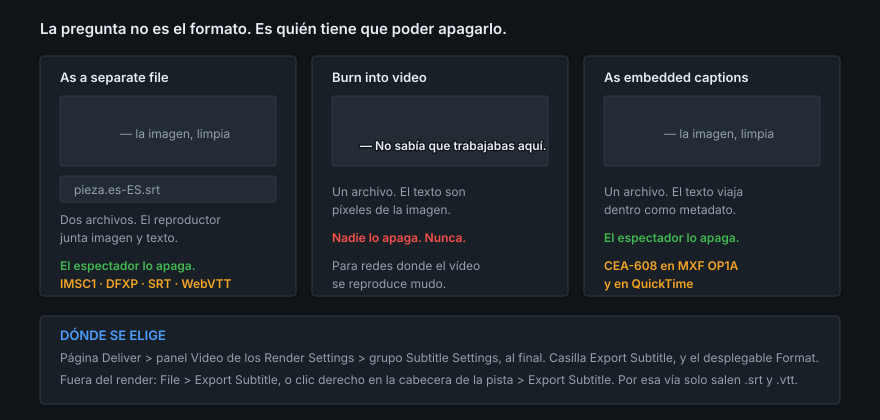

# Los formatos de subtítulo

> Un subtítulo puede salir de Resolve de tres maneras muy distintas, y la elección no es técnica:
> es sobre **quién tiene que poder apagarlo**. Un subtítulo quemado en la imagen no lo apaga nadie
> nunca. Uno en un archivo aparte lo enciende quien quiere. Los dos son correctos, para cosas
> distintas.

## 🎯 Objetivos

- Leer un archivo `.srt` y entender sus cuatro partes
- Enumerar los formatos de subtítulo que Resolve importa y exporta
- Importar un `.srt` y colocarlo en la timeline por las dos vías
- Exportar los subtítulos por las tres puertas que tiene Resolve
- Elegir entre archivo aparte, quemado e incrustado con criterio
- Explicar qué es CEA-608 y cuándo aparece

---

## 1. Qué problema resuelve

Los subtítulos casi nunca se quedan dentro de Resolve. Van a alguna parte:

- A **YouTube o Vimeo**, que quieren un archivo aparte para poder ofrecer el botón de subtítulos
- A **redes sociales**, donde el vídeo se reproduce mudo y el texto tiene que verse sí o sí
- A un **cliente o una emisora**, que pide el texto incrustado en el archivo con una norma concreta
- A un **traductor**, que quiere el texto y los tiempos, no el vídeo

Y muchas veces llegan de fuera: alguien transcribió, alguien tradujo, y lo que te dan es un archivo
de texto que hay que meter en la timeline al fotograma correcto.

---

## 2. Cómo funciona



### 2.1 Qué hay dentro de un `.srt`

**SRT** (*SubRip Subtitle*) es el formato más extendido, y es un archivo de texto plano que se abre
con cualquier editor. Cada subtítulo son cuatro partes:

```
1
00:00:04,120 --> 00:00:06,880
No sabía que trabajabas
en el hospital desde marzo.

2
00:00:07,300 --> 00:00:09,140
Empecé en enero.
```

| Parte | Qué es |
| ----- | ------ |
| **`1`** | El número de orden. Empieza en 1 y no salta |
| **`00:00:04,120 --> 00:00:06,880`** | Entrada y salida, en horas:minutos:segundos**,**milisegundos |
| Las líneas de texto | Una o dos. El salto de línea es literal |
| La línea en blanco | El separador. **Obligatoria** |

Dos detalles que rompen archivos: el separador de milisegundos es una **coma**, no un punto, y el
tiempo es **relativo al principio del vídeo**, no timecode absoluto.

Que sea texto plano tiene una consecuencia práctica: un `.srt` se corrige en cualquier editor, se
manda por correo y lo entiende cualquier programa. Es el formato de intercambio por defecto.

### 2.2 Los formatos que Resolve entiende

**Importa**: `.srt`, `.srtx`, `.vtt`, `.xml` y `.ttml`.

**Exporta**, y depende de por dónde:

| Puerta de salida | Formatos |
| ---------------- | -------- |
| `File > Export Subtitle` | `.srt` y `.vtt` |
| Clic derecho en la cabecera de la pista `>` `Export Subtitle` | `.srt` y `.vtt` |
| Página Deliver, como archivo aparte | **IMSC1**, **DFXP**, **SRT** y **WebVTT** |

**WebVTT** (`.vtt`) es el formato de la web: el que usa la etiqueta `<track>` de HTML5. **IMSC1** y
**DFXP** son formatos XML con más capacidad de estilo, habituales en entrega profesional.

### 2.3 Importar un archivo de subtítulos

Dos vías para meterlo en el media pool:

- Como cualquier medio: arrastrarlo, o el menú contextual del media pool. Los archivos compatibles
  se ven como un clip en blanco con un icono de subtítulo en la esquina
- **`Import Subtitle`**: clic derecho sobre un bin, o en el fondo del media pool, `>` `Import
  Subtitle`, y elige el archivo

En los dos casos queda **un solo elemento** en el media pool, con su distintivo. Todavía no está en
la timeline.

### 2.4 Colocarlo en la timeline

Aquí está la decisión que importa: **¿el archivo tiene los tiempos de tu timeline, o no?**

**Si los tiene** —lo generó alguien a partir de tu montaje—: clic derecho sobre el clip de
subtítulos `>` **`Insert Selected Subtitles to Timeline Using Timecode`**. Se descompone en
subtítulos sueltos, cada uno en su fotograma, sin tocar nada.

**Si no los tiene**: se arrastra.

- Arrástralo a la **zona gris vacía encima de las pistas de vídeo**, y Resolve crea la pista de
  subtítulos sola
- O arrástralo **a una pista de subtítulos** que ya exista

Al soltarlo se **descompone**: cada subtítulo del archivo se convierte en un clip independiente en
la pista, con sus tiempos relativos al primero. Si lo has soltado en el sitio equivocado, se
seleccionan todos y se deslizan juntos.

> [!TIP]
> Un archivo de subtítulos se puede **relinkar** en el media pool, igual que un vídeo. Si lo mueves
> de carpeta, no hay que reimportarlo.

### 2.5 Las tres salidas del render

En la página **Deliver**, al final del panel `Video` de los `Render Settings`, hay un grupo
**`Subtitle Settings`** con una casilla `Export Subtitle` y un desplegable `Format` con tres
opciones:

**`As a separate file`** — saca cada pista de subtítulos que marques como un **archivo aparte**, en
el formato que elijas en `Export As`. La imagen sale limpia.

> **Cuándo**: YouTube, Vimeo, cualquier plataforma con botón de subtítulos, y siempre que quieras
> poder cambiar el texto sin volver a renderizar.

**`Burn into video`** — renderiza el vídeo con la pista de subtítulos **quemada en la imagen**. El
texto pasa a ser píxeles.

> **Cuándo**: redes sociales donde el vídeo arranca mudo y sin controles, pantallas públicas, y
> cualquier sitio donde no puedas garantizar que el reproductor cargue el archivo aparte.
>
> **Qué cuesta**: no hay vuelta atrás. Una errata se arregla renderizando otra vez la pieza entera.

**`As embedded captions`** — mete los subtítulos **dentro del archivo de vídeo** como una capa de
metadatos. Hay soporte para **CEA-608** en **MXF OP1A** y en **QuickTime**. El desplegable `Codec`
elige entre `Text` y `CEA-608`.

> **Cuándo**: entregas a emisoras y clientes que lo piden por especificación.

**CEA-608** es la norma de *closed captions* de la televisión estadounidense —la que hereda del
teletexto analógico— y es lo que muchas especificaciones de entrega siguen exigiendo. El manual
avisa de un límite: **no hay salida de closed captions ni analógica (Line 21) ni digital (CEA-708)
por Decklink ni por UltraStudio**.

### 2.6 La vuelta: subtitular en Free con ayuda externa

`Create Subtitles from Audio` es de Studio, pero la pista de subtítulos y la importación de `.srt`
no lo son. De ahí sale un camino perfectamente válido en Free:

1. Exporta el audio de tu pieza, o la pieza entera
2. Transcríbela con la herramienta que prefieras, siempre que pueda dar un `.srt`
3. Importa el `.srt` en Resolve
4. Colócalo en la pista y **corrígelo** —los tiempos y el texto— con las herramientas de la Teoría 05

El paso 4 no es opcional con ninguna transcripción automática, ni siquiera la de Studio. Y el
resultado es el mismo archivo de salida.

> [!IMPORTANT]
> Si transcribes con un servicio en línea, **estás subiendo el audio de tu pieza a un tercero**.
> Con material propio y sin nada sensible dentro, es una decisión tuya. Con una entrevista a una
> persona que no lo ha autorizado, no lo es: pregunta antes.

---

## 3. Cómo se hace en Resolve 21

### 3.1 Importar un `.srt` y colocarlo

1. Selecciona el bin donde quieres que caiga
2. Clic derecho en el media pool `>` `Import Subtitle`, y elige el archivo
3. Si el archivo tiene los tiempos de tu timeline: clic derecho sobre el clip `>`
   `Insert Selected Subtitles to Timeline Using Timecode`
4. Si no: arrástralo a la pista de subtítulos, o a la zona gris de encima de las pistas de vídeo
5. Si quedó descolocado, selecciona todos los subtítulos y deslízalos juntos

### 3.2 Exportar la pista como `.srt`

Por el menú: `File > Export Subtitle`, elige carpeta y tipo.

Por la pista: clic derecho sobre la **cabecera** de la pista `>` `Export Subtitle`.

### 3.3 Sacar un archivo aparte al renderizar

1. Página **Deliver**
2. Panel `Video` de los `Render Settings`, hasta el final
3. Marca **`Export Subtitle`**
4. `Format` `>` **`As a separate file`**
5. `Export As` `>` **`SRT`**
6. Marca las pistas que quieras en `Include the following subtitle tracks in the export`

### 3.4 Quemarlos en la imagen

Lo mismo, pero `Format` `>` **`Burn into video`**.

> [!WARNING]
> Se quema **la pista de subtítulos que esté habilitada**, y solo esa. Antes de renderizar,
> comprueba cuál está encendida: es el fallo que hace entregar la pieza en el idioma equivocado.

---

## 4. Antipatrones

| Antipatrón | Por qué duele | Qué hacer |
| ---------- | ------------- | --------- |
| Quemar los subtítulos por costumbre | Una errata cuesta renderizar la pieza entera | Archivo aparte, salvo que el destino lo exija |
| Sacar archivo aparte para Instagram | El reproductor no lo carga y nadie los ve | Quemados, ahí sí |
| Renderizar sin mirar qué pista está habilitada | Se entrega el idioma equivocado | Comprueba el control de habilitación antes |
| Arrastrar el `.srt` a la timeline teniendo timecode | Queda descolocado y hay que deslizarlo a mano | `Insert Selected Subtitles to Timeline Using Timecode` |
| Editar un `.srt` a mano y poner punto en los milisegundos | El archivo deja de ser válido | Es una coma |
| Numerar mal los subtítulos al editar a mano | Los reproductores se saltan bloques | Números seguidos desde 1 |
| Confiar en una transcripción automática sin repasar | Nombres propios y cifras salen mal | Repaso completo, siempre |
| Subir a un servicio en línea el audio de una entrevista ajena | No es material tuyo | Pídelo antes |
| Dejar la pista con nombre de fábrica antes de exportar | El nombre viaja al archivo | Renómbrala con su código de idioma |

---

## 5. Trucos

| Truco | Cómo |
| ----- | ---- |
| Importar un archivo de subtítulos | Clic derecho en el media pool `>` `Import Subtitle` |
| Colocarlo respetando su timecode | Clic derecho sobre el clip `>` `Insert Selected Subtitles to Timeline Using Timecode` |
| Crear la pista y colocarlo de una vez | Arrástralo a la zona gris de encima de las pistas de vídeo |
| Recolocar todos los subtítulos a la vez | Selecciónalos todos y deslízalos |
| Volver a enlazar un `.srt` movido de carpeta | Se relinka como cualquier medio |
| Exportar rápido | Clic derecho en la cabecera de la pista `>` `Export Subtitle` |
| Elegir formato en la entrega | Deliver `>` `Video` `>` `Subtitle Settings` `>` `Export As` |
| Sacar varios idiomas de una tacada | `As a separate file` y marca varias pistas |
| Comprobar un `.srt` sin abrir Resolve | Es texto plano: ábrelo con cualquier editor |
| Mandar los subtítulos a traducir | Exporta `.srt`: lleva texto y tiempos, y pesa nada |

---

## 📚 Recursos Adicionales

- [DaVinci Resolve Reference Manual](https://www.blackmagicdesign.com/support/family/davinci-resolve-and-fusion) — capítulo 59, «Importing Subtitles and Captions» y «Exporting Subtitles and Closed Captions».
- [WebVTT: The Web Video Text Tracks Format (W3C)](https://www.w3.org/TR/webvtt1/) — la especificación del formato de subtítulos de la web, la que carga la etiqueta `<track>` de HTML5.
- [05 · Escribir y estilar subtítulos](05-escribir-y-estilar-subtitulos.md) — lo que hay que corregir después de importar.
- [09 · Intercambio: XML, AAF, EDL y OTIO](09-intercambio-xml-aaf-edl-otio.md) — la misma idea aplicada a la timeline entera.

---

## ✅ Checklist de Verificación

- [ ] Sé leer un `.srt` y sé sus cuatro partes
- [ ] Sé qué formatos importa Resolve y cuáles exporta por cada puerta
- [ ] Sé importar un archivo de subtítulos y colocarlo por timecode
- [ ] Sé colocarlo a mano cuando el timecode no cuadra
- [ ] Sé elegir entre archivo aparte, quemado e incrustado
- [ ] Sé qué es CEA-608 y dónde se usa
- [ ] Sé subtitular en Free sin `Create Subtitles from Audio`

---

| Anterior | Actual | Siguiente |
| -------- | ------ | --------- |
| [05 · Escribir y estilar subtítulos](05-escribir-y-estilar-subtitulos.md) | **06 · Los formatos de subtítulo** | [07 · Versionar timelines](07-versionar-timelines.md) |

← [Volver a la Semana 12](../README.md)
