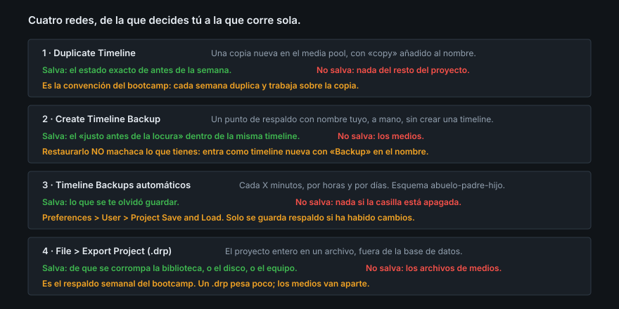

# Versionar timelines

> Llevas doce semanas duplicando la timeline cada vez que empieza una fase, sin que nadie te haya
> explicado del todo por qué esa y no otra de las cuatro redes de seguridad que tiene Resolve. Esta
> es la semana en que se ven las cuatro juntas y se entiende qué salva cada una.

## 🎯 Objetivos

- Enumerar las cuatro formas de tener una red de seguridad y decir qué salva cada una
- Duplicar una timeline y saber qué nombre le pone Resolve
- Crear un punto de respaldo con nombre y restaurarlo sin machacar el trabajo
- Configurar los respaldos automáticos y saber dónde caen
- Comparar la timeline actual con un respaldo anterior
- Desactivar timelines viejas para que el proyecto no se arrastre
- Exportar e importar una timeline suelta como `.drt`

---

## 1. Qué problema resuelve

Dos situaciones distintas que se confunden todo el rato:

**«Quiero poder volver al estado de antes de esta semana.»** Eso es versionar. Es una decisión tuya,
consciente, en un momento concreto, y el resultado es una timeline nueva con nombre.

**«Se ha ido la luz y llevaba dos horas sin guardar.»** Eso es respaldar. No es una decisión: es una
red que tiene que estar puesta antes de que pase.

Resolve tiene herramientas para las dos, y son distintas. Usar la de respaldo para versionar deja un
historial ilegible; usar la de versionado para respaldar no salva nada, porque nadie duplica la
timeline cada diez minutos.

---

## 2. Cómo funciona

### 2.1 Duplicar la timeline

La red que usas cada semana, y la que el manual llama **la más segura** para marcar un punto antes
de un cambio grande.

| Vía | Cómo |
| --- | ---- |
| Menú | Selecciona la timeline en el media pool `>` `Edit > Duplicate Timeline` |
| Teclado | `Ctrl+4` (Win) / `Cmd+4` (Mac) da el foco a la timeline, y luego `Edit > Duplicate Timeline` |
| Contextual | Clic derecho sobre la timeline en el media pool `>` `Duplicate Timeline` |

La copia aparece con **`copy` añadido al nombre**. Ese nombre no vale: renómbrala inmediatamente con
la convención del bootcamp, `BC-Montaje-v6`, porque el verificador busca nombres exactos y porque
`BC-Montaje-v5 copy` no dice nada dentro de tres semanas.

Qué salva: el estado exacto de esa timeline. Qué no salva: nada más del proyecto, y ningún archivo
de medios.

### 2.2 Desactivar las timelines viejas

Con doce semanas y una timeline nueva cada dos o tres, el media pool se llena. Y no es solo
estética: el manual dice que **un número grande de timelines en un proyecto afecta al rendimiento**.

La solución es **desactivarlas**: clic derecho sobre la timeline `>` `Disable Timeline`.

Una timeline desactivada:

- **No se carga en memoria**
- No afecta a lo que tarda el proyecto en abrir, guardar, exportar o cargar
- Desaparece de los desplegables de timeline de todo el programa
- Sigue visible en el media pool, con un **icono de ojo tachado** en la esquina inferior izquierda
- **No se puede abrir** en ninguna página hasta que la vuelvas a activar

Se recupera con `Enable Timeline`. Nada se pierde.

> [!TIP]
> Se pueden agrupar todas las desactivadas en un smart bin, con el campo
> `MediaPool Properties > Timeline` y la condición `is Enabled/Disabled`.

### 2.3 Los respaldos automáticos

En `Preferences > User > Project Save and Load` hay una casilla **`Timeline Backups`**. Encendida,
Resolve guarda respaldos de la timeline a intervalos, con un esquema **abuelo-padre-hijo**: muchos
recientes, menos antiguos, todavía menos viejos.

Cuatro ajustes, compartidos con los respaldos de proyecto:

| Ajuste | Por defecto | Qué hace |
| ------ | ----------- | -------- |
| `Perform backups every X minutes` | 10 min | Los respaldos de la última hora. Seis, por defecto |
| `Hourly backups for the past X hours` | 2 | Cuántos respaldos por hora se guardan del día |
| `Daily backups for the past X days` | 2 | Cuántos días se guarda el último respaldo del día |
| `Project backup location` | Un directorio `Project Backup` en el disco de caché | Dónde caen |

Dos detalles del comportamiento que evitan sustos:

- **Solo se guarda respaldo si ha habido cambios.** Dejar Resolve abierto sin tocar nada no machaca
  los respaldos útiles con copias idénticas
- Funciona **independientemente de `Live Save`**. Son cosas distintas: `Live Save` guarda tu
  proyecto continuamente; `Timeline Backups` guarda copias fechadas a las que puedes volver

> [!IMPORTANT]
> Si `Daily backups for the past X days` está en 2 y trabajas en una pieza durante nueve meses,
> **súbelo**. El valor de fábrica está pensado para un encargo de una semana.

### 2.4 Los puntos de respaldo con nombre

Hay momentos en los que sabes que vas a hacer una barbaridad. Para eso está
**`Create Timeline Backup`**: un punto de respaldo, con el nombre que le pongas, sin crear una
timeline nueva en el media pool.

| Vía | Cómo |
| --- | ---- |
| Menú | `File > Create Timeline Backup` — `Alt+Ctrl+S` (Win) / `Opt+Cmd+S` (Mac) |
| Contextual | Clic derecho sobre la timeline en el media pool `>` `Create Timeline Backup` |

Y para volver: clic derecho sobre la timeline `>` **`Restore Timeline Backup`**, y elige de la lista,
que está ordenada por fecha y hora.

> [!NOTE]
> **Restaurar no machaca lo que tienes.** El respaldo entra en el media pool como una **timeline
> nueva**, con `Backup` añadido al nombre. Tu timeline actual sigue intacta. Es la diferencia con
> «restaurar» en casi cualquier otro programa, y es lo que hace que probar sea gratis.

### 2.5 Recuperar lo borrado y comparar

**`Deleted Timeline Backups`**, en el menú de opciones del media pool: enseña las timelines borradas
y los respaldos disponibles de cada una. Se pueden restaurar, o borrar del todo.

**`Compare with Timeline Backup`**, en el menú contextual de una timeline: abre la ventana
`Compare Timeline`, que enseña las dos timelines apiladas y **resalta las diferencias**. El
desplegable de arriba elige contra qué respaldo comparar.

Es la herramienta que responde a «¿qué cambié ayer?» sin reproducir las dos versiones enteras.

### 2.6 Exportar e importar una timeline: `.drt`

Un **`.drt`** (*DaVinci Resolve Timeline*) es una timeline suelta en un archivo. Sirve para pasarla
de un proyecto de Resolve a otro, o de un equipo a otro, **sin exportar el proyecto entero**.

Lleva la timeline y la información de sus clips. **No lleva los archivos de medios.**

| Acción | Cómo |
| ------ | ---- |
| Exportar | Selecciona la timeline en el media pool `>` `File > Export > Export AAF, XML, DRT` — `Ctrl+Shift+O` (Win) / `Cmd+Shift+O` (Mac) |
| Importar | Doble clic sobre el `.drt` en el explorador de archivos |

Al importar, la timeline aparece en el media pool con **`import` añadido al nombre**, para no chocar
con una que ya exista, y se conforma automáticamente contra los medios que ya estén en el media
pool. Si viene de otro equipo, habrá que relinkar.

> [!NOTE]
> **Una timeline por archivo.** Para varias a la vez, la vía es exportar e importar un bin entero.

### 2.7 Cuál usar para qué

| Situación | Herramienta |
| --------- | ----------- |
| Empieza una fase nueva del proyecto | **Duplicar** la timeline y renombrarla |
| Voy a probar algo que puede salir mal | **`Create Timeline Backup`** con un nombre que lo diga |
| Se ha ido la luz | **Respaldos automáticos**, si estaban encendidos |
| Quiero saber qué cambié ayer | **`Compare with Timeline Backup`** |
| Borré una timeline sin querer | **`Deleted Timeline Backups`** |
| El media pool va lento con veinte timelines | **`Disable Timeline`** en las viejas |
| Quiero llevar una timeline a otro proyecto | **`.drt`** |
| Quiero llevarme el proyecto entero | **`File > Export Project`**, el `.drp` de cada semana |

---

## 3. Cómo se hace en Resolve 21

### 3.1 Abrir la semana

1. Clic derecho sobre `BC-Montaje-v5` en el media pool `>` `Duplicate Timeline`
2. Aparece `BC-Montaje-v5 copy`
3. Doble clic lento sobre el nombre y escribe **`BC-Montaje-v6`**
4. Doble clic sobre ella para abrirla

### 3.2 Encender los respaldos automáticos

1. `DaVinci Resolve > Preferences > User > Project Save and Load`
2. Marca **`Timeline Backups`**
3. Sube `Daily backups for the past X days` a un número que cubra tu ritmo
4. Mira `Project backup location` y comprueba que es un disco que existe y tiene sitio

### 3.3 Marcar un punto antes de una prueba

1. `File > Create Timeline Backup`
2. Ponle un nombre que diga qué venía después: `antes-de-subtitular`

Para volver: clic derecho sobre la timeline `>` `Restore Timeline Backup` `>` ese punto. Entra como
timeline nueva con `Backup` en el nombre.

### 3.4 Limpiar el media pool sin borrar nada

1. Selecciona las timelines de semanas cerradas
2. Clic derecho `>` `Disable Timeline`
3. Comprueba el ojo tachado en la esquina de sus miniaturas

---

## 4. Antipatrones

| Antipatrón | Por qué duele | Qué hacer |
| ---------- | ------------- | --------- |
| Trabajar siempre sobre la misma timeline | No hay a dónde volver, y no se puede comparar | Duplica al empezar cada fase |
| Dejar el nombre `BC-Montaje-v5 copy` | El verificador no la encuentra, y dentro de un mes tú tampoco | Renómbrala en cuanto se crea |
| Borrar las timelines viejas para aligerar | Se pierde el historial del proyecto | `Disable Timeline` |
| Confiar en los respaldos automáticos sin haberlos encendido | La casilla no viene marcada de fábrica en todas las instalaciones | Compruébalo hoy |
| Dejar `Daily backups` en 2 en una pieza de nueve meses | Solo tienes los dos últimos días | Súbelo |
| Guardar los respaldos en el disco de trabajo | Si se cae ese disco, te lleva las dos cosas | Otro volumen |
| Usar el `.drt` como respaldo | No lleva ni medios ni el resto del proyecto | El respaldo es el `.drp` |
| Esperar que restaurar un respaldo machaque la timeline actual | No lo hace, y se acaban con dos timelines confusas | Entra como timeline nueva: renómbrala o bórrala |

---

## 5. Trucos

| Truco | Cómo |
| ----- | ---- |
| Duplicar la timeline abierta | `Ctrl+4` / `Cmd+4` y `Edit > Duplicate Timeline` |
| Marcar un punto antes de una prueba | `Alt+Ctrl+S` (Win) / `Opt+Cmd+S` (Mac) |
| Volver a un punto anterior | Clic derecho `>` `Restore Timeline Backup` |
| Ver qué cambió respecto a ayer | Clic derecho `>` `Compare with Timeline Backup` |
| Recuperar una timeline borrada | Menú de opciones del media pool `>` `Deleted Timeline Backups` |
| Aligerar un proyecto con muchas timelines | `Disable Timeline` en las cerradas |
| Reconocer una timeline desactivada | El ojo tachado de la esquina inferior izquierda |
| Agrupar las desactivadas | Smart bin con `MediaPool Properties > Timeline` `is Disabled` |
| Llevar una timeline a otro proyecto | Exporta `.drt` y haz doble clic en el archivo |
| Saber dónde caen los respaldos | `Preferences > User > Project Save and Load > Project backup location` |

---

## 📚 Recursos Adicionales

- [DaVinci Resolve Reference Manual](https://www.blackmagicdesign.com/support/family/davinci-resolve-and-fusion) — capítulo 41, «Duplicating Timelines», «Disabling Timelines», «Import and Export DaVinci Resolve Timelines (.drt)», «Backing Up and Restoring Timelines», «Restoring Deleted Timeline Backups» y «Compare Timelines with Timeline Backup Snapshots».
- [`docs/proyecto-hilo-conductor.md`](../../../docs/proyecto-hilo-conductor.md) — la convención de versionado del bootcamp, y por qué cada fase duplica.
- [08 · Media Management](08-media-management.md) — la otra mitad de la gestión: los archivos, no las decisiones.
- [09 · Intercambio: XML, AAF, EDL y OTIO](09-intercambio-xml-aaf-edl-otio.md) — sacar una timeline fuera de Resolve.

---

## ✅ Checklist de Verificación

- [ ] Sé las cuatro redes de seguridad y qué salva cada una
- [ ] Sé duplicar una timeline y por qué hay que renombrarla enseguida
- [ ] Sé crear un punto de respaldo con nombre y restaurarlo
- [ ] Sé que restaurar no machaca la timeline actual
- [ ] Sé configurar los respaldos automáticos y dónde caen
- [ ] Sé comparar mi timeline con un respaldo anterior
- [ ] Sé desactivar timelines viejas y por qué mejora el rendimiento
- [ ] Sé qué lleva un `.drt` y qué no

---

| Anterior | Actual | Siguiente |
| -------- | ------ | --------- |
| [06 · Los formatos de subtítulo](06-los-formatos-de-subtitulo.md) | **07 · Versionar timelines** | [08 · Media Management](08-media-management.md) |

← [Volver a la Semana 12](../README.md)
