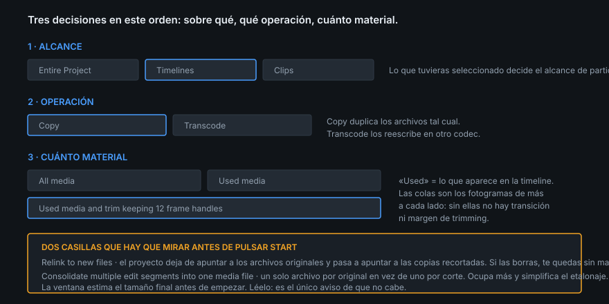

# Media Management

> Tu proyecto ocupa 400 GB y tu montaje usa 12. Los otros 388 son tomas descartadas y colas que no
> vas a volver a mirar. **Media Management** es la herramienta que separa una cosa de la otra —y es
> también la que, mal usada, deja el proyecto apuntando a unos archivos recortados que ya no se
> pueden reabrir.

## 🎯 Objetivos

- Explicar qué hace Media Management y en qué se diferencia de copiar archivos a mano
- Elegir el alcance: proyecto entero, timelines o clips
- Distinguir `Copy` de `Transcode`
- Entender qué son las **colas** y por qué el número por defecto es 12 fotogramas
- Explicar qué hace `Relink to new files` y por qué es la casilla peligrosa
- Reconocer los tres casos reales en los que esto se usa
- Saber que la operación genera un `.drt` y por qué

---

## 1. Qué problema resuelve

Tres situaciones concretas, y son las tres del manual:

1. **Entregar el material a otro sitio.** Otra sala, otro montador, otro estudio de color. No les
   vas a mandar 400 GB de descartes: les mandas lo que la timeline usa
2. **Aligerar un proyecto.** Ingestaste todo, montaste, y ahora el media pool tiene doscientos
   clips de los que usas cuarenta. Consolidar el material deja el proyecto manejable
3. **Recibir demasiado material.** Te dan un disco USB lento con todo el rodaje y un XML. No quieres
   copiar 2 TB a tu disco rápido: quieres los clips que el XML usa, y nada más

Copiar a mano no sirve para ninguna: **tú no sabes qué archivos usa la timeline**, y aunque los
supieras, no sabes qué trozo de cada uno.

---

## 2. Cómo funciona

### 2.1 Tres decisiones, en este orden

Se abre con **`File > Media Management`**, y la ventana pregunta tres cosas.

**1 · Alcance** — `Entire Project`, `Timelines` o `Clips`. Lo que tuvieras seleccionado en el media
pool antes de abrir la ventana decide cuál viene marcado, pero no te ata: se puede cambiar.

Con `Timelines` aparece además un desplegable `Timeline selection`, con una casilla por timeline,
para elegir cuáles entran.

**2 · Operación** — dos, en la versión 21:

| Operación | Qué hace |
| --------- | -------- |
| **`Copy`** | Duplica los archivos **tal cual** en el destino |
| **`Transcode`** | Los reescribe **en otro codec** que eliges tú |

`Copy` es rápido y no toca la calidad. `Transcode` es lento, pasa por el motor de render, y sirve
para uniformar un rodaje con seis formatos distintos en uno solo.

**3 · Cuánto material**:

| Opción | Qué copia |
| ------ | --------- |
| **`All media`** | Todo lo que haya en el alcance elegido |
| **`Used media`** | Solo los archivos que aparecen en alguna timeline, **enteros** |
| **`Used media and trim keeping X frame handles`** | Solo lo usado, **recortado**, dejando X fotogramas de margen a cada lado |

La tercera es la que ahorra los 388 GB. Y la que necesita entenderse antes de usarse.

### 2.2 Las colas

Ya salieron en la Semana 11 con las transiciones, y aquí valen lo mismo. Una **cola** (*handle*) son
los fotogramas de más que quedan a cada lado del trozo que usas.

Si recortas un plano de 10 s a 3 s, hay 7 s de material fuera. Con `trim keeping 12 frame handles`,
Resolve copia esos 3 s **más 12 fotogramas antes y 12 después**.

Por qué hacen falta:

- Sin colas **no hay transiciones**: una disolución se construye con material de fuera del corte
- Sin colas **no hay trimming**: no puedes alargar un plano ni un fotograma
- Sin colas, una corrección de sincronía de dos fotogramas es imposible

Por qué 12: es el valor por defecto de Resolve y una convención de la industria, medio segundo a
24 fps. Es poco si todavía vas a montar, y suficiente si el montaje está cerrado y solo queda color.

> [!IMPORTANT]
> **Recortar es la parte irreversible.** Los archivos nuevos ya no contienen el resto de la toma. Si
> luego relinkas el proyecto a ellos y borras los originales, ese material **no existe**. Recorta
> cuando el montaje esté cerrado, no antes.

Las opciones de recorte funcionan también con codecs de compresión temporal —H.264, XAVC, AVC-Intra,
mp3, Flac y QuickTime—, **sin recomprimir**. No es poco: significa que se puede recortar material de
cámara de consumo sin perder calidad.

### 2.3 Las casillas que hay que mirar

**`Relink to new files`** —solo en `Copy`— hace que el proyecto **deje de apuntar a los archivos
originales y pase a apuntar a las copias**.

Es exactamente lo que quieres cuando estás consolidando para seguir trabajando desde el disco rápido.
Y es exactamente lo que **no** quieres si las copias son un entregable para otro y tú vas a seguir
con los originales.

> [!WARNING]
> Con `Relink to new files` marcado y `trim` activo, tu proyecto pasa a depender de unos archivos
> recortados. **Si los borras, te quedas sin material y el proyecto se queda offline.** Antes de
> marcarla, ten claro cuál de las dos copias es la que vas a conservar.

**`Consolidate multiple edit segments into one media file`** —solo con `trim` activo— hace que
varios trozos del mismo archivo original salgan en **un solo archivo** en vez de en uno por corte,
incluyendo los fotogramas que quedan entre ellos.

Ocupa más. A cambio conserva la relación entre cada clip y su archivo de origen, que es lo que
permite el enlazado automático de grados de la Fase 5. Si vas a etalonar después, márcala.

Si **no** la marcas, Resolve añade sufijos a los archivos recortados para que no se pisen:
`_0`, `_1` en DPX; `_S000.RDC`, `_S001.RDC` en R3D; `_S000.mov`, `_S001.mov` en QuickTime.

**`Use project name subfolder`** crea una carpeta con el nombre del proyecto dentro del destino. Con
dos proyectos gestionados al mismo destino, es lo que evita el desastre.

**`Preserve folder hierarchy after X folder levels`** reconstruye X niveles de la estructura de
carpetas original. Por defecto 0, que no crea ninguna.

### 2.4 La estimación de tamaño

Debajo de las opciones, la ventana enseña **el tamaño actual del material seleccionado y una
estimación del tamaño después**. Cambia según lo que marques.

Es el único aviso de que la operación no cabe en el destino, y es el motivo por el que hay que
abrir esta ventana y leerla antes de tocar nada.

### 2.5 El `.drt` que aparece solo

Cuando la operación es sobre timelines, Resolve crea automáticamente **un archivo `.drt`** en el
mismo bin que los medios resultantes, ya enlazado a ellos.

Es lo que hace que el paquete sea autosuficiente: quien reciba la carpeta tiene los medios **y** la
timeline que los usa, y solo tiene que importar el `.drt`.

### 2.6 Qué formatos entran

Media Management funciona con todo lo que Resolve sabe descodificar, y saca algún formato más que la
página Deliver: QuickTime, MXF, R3D, formatos RAW de imagen incluidos Blackmagic RAW y Alexa raw,
DPX, EXR, JPEG 2000, TIFF, Cineon y otras secuencias de imagen, AVI, H.264, XAVC y AVC-Intra.

> [!NOTE]
> **Los medios optimizados y los proxies de la Semana 05 no entran** en las operaciones de Media
> Management. Se regeneran en destino; no se copian.

---

## 3. Cómo se hace en Resolve 21

> [!WARNING]
> **Media Management escribe en disco y puede llenarlo.** Antes de pulsar `Start`: mira la
> estimación de tamaño, comprueba el espacio libre del destino, y ten el respaldo `.drp` de la
> semana exportado. Con `Relink to new files` marcado, además, el proyecto cambia a qué archivos
> apunta.
>
> En la práctica de esta semana **la ventana se abre, se lee y se cancela**. No se ejecuta.

### 3.1 Consolidar el material de una timeline

1. Selecciona la timeline en el media pool
2. `File > Media Management`
3. Alcance: **`Timelines`**, y marca la tuya en `Timeline selection`
4. Operación: **`Copy`**
5. `Browse` y elige el destino
6. Marca **`Copy and trim used media keeping 12 frame handles`**
7. Marca **`Consolidate multiple edit segments into one media file`** si vas a etalonar
8. Marca **`Relink to new files`** **solo** si vas a seguir trabajando sobre las copias
9. **Lee la estimación de tamaño**
10. `Start`

### 3.2 Preparar un entregable para otra sala

Igual, pero **sin** `Relink to new files`: tú te quedas con tus originales y ellos reciben la
carpeta. Dentro va el `.drt` que Resolve genera solo.

### 3.3 Uniformar seis formatos en uno

1. Alcance `Timelines`
2. Operación **`Transcode`**
3. Los paneles `Settings`, `Video` y `Audio` para elegir el codec de destino
4. `Start`, y ponte a otra cosa: pasa por el motor de render

---

## 4. Antipatrones

| Antipatrón | Por qué duele | Qué hacer |
| ---------- | ------------- | --------- |
| Copiar los archivos a mano | No sabes cuáles usa la timeline ni qué trozo | Media Management |
| Recortar con el montaje sin cerrar | Te quedas sin material para alargar un plano | Recorta al final |
| `Relink to new files` sin pensarlo | El proyecto pasa a depender de las copias recortadas | Solo si vas a trabajar sobre ellas |
| Borrar los originales después de recortar | El material que sobraba deja de existir | Consérvalos hasta cerrar la pieza |
| No leer la estimación de tamaño | La operación se para a mitad con el disco lleno | Léela: para eso está |
| Colas de 0 fotogramas | Ninguna transición, ningún trimming, ninguna corrección | 12 como mínimo, más si vas a seguir montando |
| No marcar `Use project name subfolder` | Dos proyectos al mismo destino se pisan | Márcala |
| Esperar que los proxies viajen | No entran en Media Management | Se regeneran en destino |
| Usar Media Management como respaldo | Copia medios, no el proyecto | El respaldo es el `.drp` |

---

## 5. Trucos

| Truco | Cómo |
| ----- | ---- |
| Abrir la ventana | `File > Media Management` |
| Fijar el alcance sin tocar la ventana | Selecciona antes en el media pool lo que quieras gestionar |
| Elegir qué timelines entran | El desplegable `Timeline selection` |
| Quedarte solo con lo que usa el montaje | `Copy and trim used media keeping X frame handles` |
| Margen para seguir montando | Sube las colas por encima de 12 |
| Conservar la relación clip-archivo para el color | `Consolidate multiple edit segments into one media file` |
| Que el proyecto pase a usar las copias | `Relink to new files` — y saber lo que implica |
| Evitar que dos proyectos se pisen en el destino | `Use project name subfolder` |
| Reconstruir parte del árbol de carpetas | `Preserve folder hierarchy after X folder levels` |
| Saber si cabe antes de empezar | La estimación de tamaño, debajo de las opciones |
| Entregar un paquete que se abra solo | El `.drt` que Resolve genera en el bin de los medios |

---

## 📚 Recursos Adicionales

- [DaVinci Resolve Reference Manual](https://www.blackmagicdesign.com/support/family/davinci-resolve-and-fusion) — capítulo 53, «Media Management»: «What Is Media Management in DaVinci Resolve?», «Using Media Management», «Options in the Media Management Window» y «File Naming When You Consolidate Media».
- [07 · Versionar timelines](07-versionar-timelines.md) — la gestión de las decisiones; esta es la de los archivos.
- [09 · Intercambio: XML, AAF, EDL y OTIO](09-intercambio-xml-aaf-edl-otio.md) — lo que acompaña a los medios cuando el destino no es Resolve.
- [Semana 05 · 09 · Medios offline y relink](../../week-05-proxies_cache_y_sincronizacion/1-teoria/09-medios-offline-y-relink.md) — qué pasa cuando un clip deja de encontrar su archivo.

---

## ✅ Checklist de Verificación

- [ ] Sé qué hace Media Management y por qué no se puede hacer a mano
- [ ] Sé elegir el alcance y qué timelines entran
- [ ] Sé la diferencia entre `Copy` y `Transcode`
- [ ] Sé qué son las colas y por qué 12 fotogramas
- [ ] Sé qué hace `Relink to new files` y cuándo **no** marcarla
- [ ] Sé para qué sirve consolidar en un solo archivo
- [ ] Sé leer la estimación de tamaño antes de empezar
- [ ] Sé que la operación genera un `.drt` y para qué sirve

---

| Anterior | Actual | Siguiente |
| -------- | ------ | --------- |
| [07 · Versionar timelines](07-versionar-timelines.md) | **08 · Media Management** | [09 · Intercambio: XML, AAF, EDL y OTIO](09-intercambio-xml-aaf-edl-otio.md) |

← [Volver a la Semana 12](../README.md)
