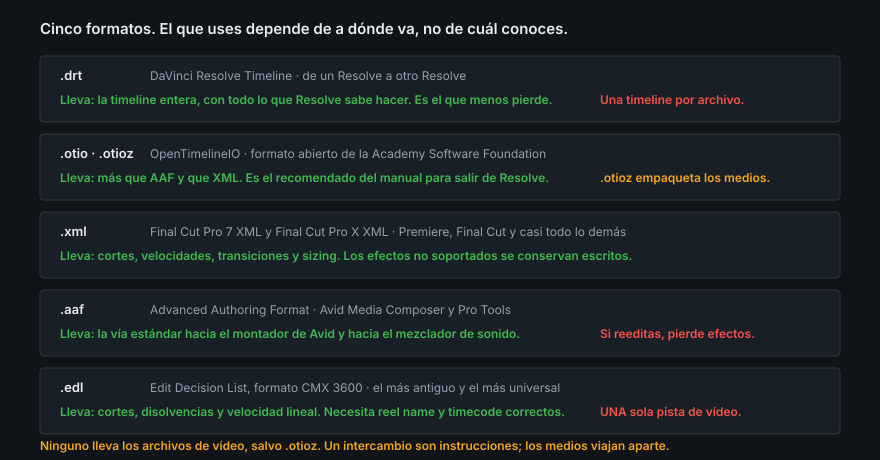

# Intercambio: XML, AAF, EDL y OTIO

> Una timeline no es un vídeo: es **una lista de instrucciones** —qué archivo, desde qué fotograma,
> hasta cuál, en qué pista—. Por eso se puede mandar a otro programa en un archivo de unos pocos
> kilobytes. Y por eso lo que llega al otro lado nunca es exactamente lo que salió.

## 🎯 Objetivos

- Explicar qué es un formato de intercambio y por qué no lleva medios
- Enumerar los cinco formatos que maneja Resolve y a dónde va cada uno
- Elegir el formato según el destino, no según cuál conoces
- Exportar una timeline en cada formato
- Importar una timeline y saber qué opciones decide el diálogo
- Anticipar qué se pierde en cada salto
- Explicar qué es un *round trip* y por qué existe

---

## 1. Qué problema resuelve

Post-producción es casi siempre más de un programa. El montador trabaja en Avid, el color se hace en
Resolve y el sonido en Pro Tools. O montas tú en Resolve y le mandas el sonido a alguien. O te llega
un proyecto de Premiere que hay que etalonar.

En todos los casos hace falta **mover la timeline sin mover los medios**, porque los medios pesan y
porque los dos programas pueden trabajar sobre los mismos archivos.

Un formato de intercambio es justo eso: un archivo de texto que dice, para cada clip, de qué archivo
sale, qué trozo y dónde va. El programa de destino lo lee, busca esos archivos y reconstruye la
timeline.

---

## 2. Cómo funciona

### 2.1 La regla que explica todo lo demás

> **Un intercambio lleva decisiones, no imágenes.**

De ahí salen las tres consecuencias que sorprenden la primera vez:

1. El archivo pesa kilobytes, no gigabytes
2. Si el destino no encuentra los medios, la timeline llega **offline**: la estructura está, las
   imágenes no
3. Lo que el destino no sabe hacer, **se pierde**. Un efecto de Resolve que Premiere no tiene no
   viaja

La única excepción es `.otioz`, que empaqueta los medios dentro.

### 2.2 Los cinco formatos

**`.drt` · DaVinci Resolve Timeline** — de un Resolve a otro Resolve. Es el que menos pierde, porque
los dos lados hablan el mismo idioma. Una timeline por archivo. Ver la
[Teoría 07](07-versionar-timelines.md).

**`.otio` y `.otioz` · OpenTimelineIO** — formato **abierto**, de la Academy Software Foundation,
pensado exactamente para este problema y sin dueño. El manual es explícito: **para salir de Resolve
hacia otra aplicación, OTIO primero**, y solo si no lo soporta, XML o AAF.

- `.otio` — solo la timeline. Pequeño; el destino enlaza sus propios medios
- `.otioz` — la timeline **y todos los medios**, empaquetados. Puede ser enorme, y a cambio el
  destino lo abre sin relinkar nada

**`.xml` · Final Cut Pro 7 XML y Final Cut Pro X XML** — el intercambio más extendido. Premiere Pro,
Final Cut y casi cualquier programa lo leen. Lleva cortes, velocidades, transiciones y encuadre.

Tiene una propiedad útil: **los efectos que Resolve no soporta se guardan escritos dentro del XML** y
reaparecen al volver al programa de origen, aunque Resolve no supiera qué eran.

**`.aaf` · Advanced Authoring Format** — la vía hacia **Avid Media Composer** y hacia **Pro Tools**.
Es el estándar del montaje y del sonido profesional. Un AAF de Pro Tools llega a Resolve como una
timeline **solo de audio**.

Tiene un comportamiento peculiar que el manual detalla: si **no** has reeditado la timeline
importada, exportar AAF reutiliza el archivo original y conserva todo, incluidos los efectos que
Resolve no entiende. Si **sí** la has reeditado, hay que usar `Timelines > Export > Generate New AAF`
y se pierden esos efectos.

**`.edl` · Edit Decision List, formato CMX 3600** — el más antiguo y el más universal. Lleva muy
poco: orden de los clips, nombre por comentario, transiciones —cortes y disolvencias— y velocidad
lineal.

Tres límites que hay que saber antes de elegirlo:

- **Una sola pista de vídeo.** Para varias, se exporta una EDL por pista y se importan con
  `Timelines > Import > EDL to New Track`
- **Todas las transiciones se convierten en disolvencias** de la misma duración al importar
- Necesita **reel name y timecode correctos** en cada archivo, o no conforma nada

### 2.3 Elegir según el destino

| A dónde va | Formato |
| ---------- | ------- |
| Otro Resolve | **`.drt`** |
| Otro programa que soporte OTIO | **`.otio`**, o `.otioz` si quieres mandar también los medios |
| Premiere Pro, Final Cut | **`.xml`** |
| Avid Media Composer | **`.aaf`** |
| Pro Tools, para la mezcla | **`.aaf`** |
| Un sistema antiguo, o solo la lista de cortes | **`.edl`** |

### 2.4 Exportar

Tres puertas, según lo que quieras:

| Qué | Cómo |
| --- | ---- |
| Timeline abierta, a AAF o XML | `File > Export AAF, XML` — `Ctrl+Shift+O` (Win) / `Cmd+Shift+O` (Mac) |
| Timeline seleccionada, a AAF, XML, DRT | `File > Export > Export AAF, XML, DRT` |
| A OTIO | `File > Export > Timeline`, y elige `.otio` o `.otioz` en el selector de formato |
| Desde el media pool | Clic derecho sobre la timeline `>` `Timelines > Export >` y el formato |
| AAF nuevo, tras reeditar | Clic derecho `>` `Timelines > Export > Generate New AAF` |

Para **EDL** hay un paso previo que se olvida siempre: una EDL exporta **solo la pista que tenga
asignado el control de destino**. Si quieres la `V2`, asigna el control de destino a la `V2` antes de
exportar.

> [!NOTE]
> Los presets de render `Final Cut Pro Round-Trip` y `Avid AAF Round-Trip` de la página Deliver
> **exportan el XML o el AAF automáticamente** junto con los archivos renderizados. Es lo que
> significa *round trip*: sale, se trabaja fuera, y vuelve.

### 2.5 Importar

| Vía | Cómo |
| --- | ---- |
| Menú | `File > Import Timeline` — `Ctrl+Shift+I` (Win) / `Cmd+Shift+I` (Mac) |
| Media pool | Clic derecho `>` `Timelines > Import > AAF/EDL/XML/DRT/ADL/OTIO` |
| AAF de audio a la timeline abierta | `File > Import Timeline > Import AAF to Current Timeline` |

**Antes de importar hay que tener los medios en el media pool.** El intercambio no los trae: los
busca. Si no están, la timeline llega offline.

El diálogo de importación pregunta, entre otras cosas:

- **`Source file`** — el archivo elegido
- **`Timeline name`** — cómo se va a llamar la timeline nueva. Por defecto, el nombre de la secuencia
  original. **Se puede cambiar, y hay que cambiarlo** si ya tienes una que se llama así
- **`Timeline start timecode`** — el timecode de inicio
- **`Automatically set project settings`** — aplica al proyecto el tamaño de imagen y la cadencia del
  archivo importado

> [!WARNING]
> **`Automatically set project settings` puede cambiar los ajustes de tu proyecto.** En un proyecto
> vacío es cómodo; en el tuyo, con doce semanas dentro, desmárcalo y comprueba qué cadencia trae el
> archivo. La cadencia de una timeline con clips dentro no se cambia sin consecuencias, y eso lleva
> avisado desde la Semana 01.

Se pueden seleccionar **varias timelines a la vez** —XML, AAF, FCP XML o EDL, mezcladas— en el
diálogo de importación. Se importan una tras otra, parando en cada `OK` para que ajustes sus opciones
por separado.

### 2.6 Qué se pierde en el salto

| Lo que casi siempre sobrevive | Lo que casi nunca |
| ----------------------------- | ----------------- |
| El orden y la duración de los clips | Los ResolveFX |
| Los puntos de entrada y salida de origen | Las composiciones de Fusion |
| El reparto en pistas | El etalonaje, salvo como archivo aparte |
| Los cortes y las disolvencias | Los compound clips, que suelen llegar deshechos |
| La velocidad lineal | Los clips multicámara, que llegan aplanados |
| El encuadre y el sizing, según formato | Los rótulos con tipografía propia |

De ahí la disciplina: **el intercambio se prueba antes de necesitarlo**. Exportar, reimportar y
mirar qué llegó cuesta diez minutos y evita descubrir el problema el día de la entrega.

Y de ahí también la costumbre profesional: **el intercambio se acompaña de un vídeo de referencia**
—la pieza montada, renderizada— para que el que recibe pueda comparar contra algo. Resolve puede
cargarlo como *offline reference movie* y compararlo con la timeline en el visor de origen.

---

## 3. Cómo se hace en Resolve 21

### 3.1 Probar el viaje de ida y vuelta

Es el ejercicio de esta semana y no toca nada de tu montaje:

1. Selecciona `BC-Montaje-v6` en el media pool
2. `File > Export > Export AAF, XML, DRT`, y guarda un **XML** en `04-respaldos/`
3. `File > Import Timeline`, y elige ese XML
4. En `Timeline name`, escribe **`BC-Intercambio-v1`**
5. **Desmarca** `Automatically set project settings`
6. `OK`
7. Abre las dos y compara

Lo que no llegó es lo que tienes que anotar.

### 3.2 Mandar la mezcla a Pro Tools

1. Clic derecho sobre la timeline en el media pool `>` `Timelines > Export > AAF/XML`
2. `AAF Files` en el desplegable de formato
3. El estudio de sonido recibe el AAF y los medios, o el AAF con los medios embebidos según lo que
   hayáis acordado

### 3.3 Exportar una EDL de una pista concreta

1. Asigna el **control de destino** a la pista que quieres exportar
2. Clic derecho sobre la timeline `>` `Timelines > Export > AAF/XML/EDL`
3. Elige `EDL Files` en el desplegable de abajo
4. Guardar

### 3.4 Importar un proyecto que llega de fuera

1. **Primero los medios**: impórtalos al media pool
2. `File > Import Timeline`
3. Elige el archivo
4. Revisa `Timeline name` y **desmarca** `Automatically set project settings`
5. `OK`
6. Comprueba si hay clips offline y relinka

---

## 4. Antipatrones

| Antipatrón | Por qué duele | Qué hacer |
| ---------- | ------------- | --------- |
| Esperar que el intercambio lleve los vídeos | Lleva instrucciones, no imágenes | Los medios viajan aparte, o usa `.otioz` |
| Importar antes de tener los medios | La timeline llega entera pero offline | Medios primero |
| Elegir XML para ir a otro Resolve | Pierdes lo que `.drt` sí conserva | `.drt` entre Resolves |
| Elegir EDL «porque es universal» | Una pista, y todas las transiciones acaban en disolvencia | Solo si el destino no admite otra cosa |
| Dejar `Automatically set project settings` marcado | Puede cambiar cadencia y resolución de tu proyecto | Desmárcalo y comprueba |
| Exportar EDL sin mirar el control de destino | Sale la pista equivocada | Asígnalo antes |
| Reeditar un AAF importado y exportarlo por el menú | Pierdes los efectos que Resolve no entiende | `Generate New AAF` |
| Probar el intercambio el día de la entrega | Los problemas aparecen entonces | Pruébalo antes |
| Mandar un intercambio sin vídeo de referencia | El que recibe no tiene contra qué comparar | Renderiza una referencia y mándala |

---

## 5. Trucos

| Truco | Cómo |
| ----- | ---- |
| El formato recomendado para salir de Resolve | OTIO, y si no lo admiten, XML o AAF |
| Mandar timeline y medios en un solo archivo | `.otioz` |
| Pasar una timeline a otro proyecto de Resolve | `.drt`, y doble clic en el archivo para importarla |
| Exportar la timeline abierta | `Ctrl+Shift+O` (Win) / `Cmd+Shift+O` (Mac) |
| Importar una timeline | `Ctrl+Shift+I` (Win) / `Cmd+Shift+I` (Mac) |
| Exportar desde el media pool | Clic derecho `>` `Timelines > Export >` |
| Exportar la pista que quieres en una EDL | Asígnale el control de destino antes |
| Importar varias EDL en pistas distintas | `Timelines > Import > EDL to New Track`, una por pista |
| Importar varias timelines de una vez | Selecciónalas todas en el diálogo: van una tras otra |
| Que no te cambien los ajustes del proyecto | Desmarca `Automatically set project settings` |
| Evitar un choque de nombres al importar | Cambia `Timeline name` en el diálogo |
| Comparar contra la pieza original | Cárgala como offline reference movie en el visor de origen |
| Saber qué se pierde antes de que importe | Exporta, reimporta y compara. Diez minutos |

---

## 📚 Recursos Adicionales

- [DaVinci Resolve Reference Manual](https://www.blackmagicdesign.com/support/family/davinci-resolve-and-fusion) — capítulo 22, «Importing and Conforming Timelines» —«Import AAF, EDL, XML», «Conforming EDL Files», «Conforming OTIO Files»— y capítulo 190, «Exporting Timelines to Other Applications».
- [OpenTimelineIO — Academy Software Foundation](https://opentimelineio.readthedocs.io/) — la documentación del formato abierto que el manual recomienda como primera opción.
- [07 · Versionar timelines](07-versionar-timelines.md) — el `.drt`, que es el caso Resolve-a-Resolve de esto.
- [08 · Media Management](08-media-management.md) — cómo preparar los medios que acompañan al intercambio.

---

## ✅ Checklist de Verificación

- [ ] Sé por qué un intercambio no lleva medios y qué implica
- [ ] Sé los cinco formatos y a dónde va cada uno
- [ ] Sé por qué OTIO es la primera opción para salir de Resolve
- [ ] Sé los tres límites de una EDL
- [ ] Sé exportar por cada una de las puertas
- [ ] Sé qué opciones decide el diálogo de importación, y cuál desmarcar
- [ ] Sé qué se pierde casi siempre en el salto
- [ ] Sé qué es un round trip y para qué sirve el vídeo de referencia

---

| Anterior | Actual | Siguiente |
| -------- | ------ | --------- |
| [08 · Media Management](08-media-management.md) | **09 · Intercambio: XML, AAF, EDL y OTIO** | — |

← [Volver a la Semana 12](../README.md)
